# UX Specs: Video Calls

Figma: [Video-Calling](https://www.figma.com/design/WcvNikeYFxnW15IaZU9JM0) (board 1335:418726, may be stale) · [Call Card](https://www.figma.com/design/uHkbu1krioaScJ3AfxLPg2?node-id=2801-2389) (frame 2801:2389)
Prototype: [Video Calls](https://video-calls-prototype.vercel.app/prototypes/video-calls) (mattermost-proto-playground, PR #84, branch `claude/practical-goodall-ac0d7b`)

---

## Overview

Mattermost Calls gains video. The first release is 1:1 video calls in direct messages (DMs). Multi-party video calls, up to 10 people in group messages (GMs) and channels, follow next. This spec covers how a person starts, joins, runs and leaves a video call from a DM, GM or channel, on desktop. It describes the in-conversation surfaces (header entry points, call banner, call card, sidebar indicator, call widget) and the expanded call window.

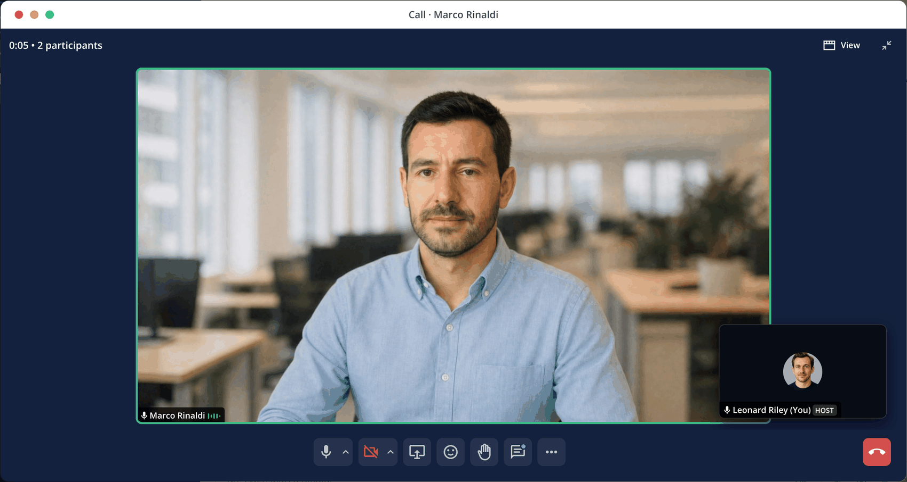

Background (not a requirement source): the FY28 Multi-party Video two-pager is an engineering brief and is not quoted here.

Related specs affected by the introduction of video calling:

- [Calls UX Improvements for DM Calls](https://mattermost.atlassian.net/wiki/spaces/DES/pages/4653645825/Calls+UX+Improvements+for+DM+Calls)
- Outbound SIP calling: [UX Spec: Outbound Calls — Implementation Tiers](https://mattermost.atlassian.net/wiki/spaces/DES/pages/4647059458/UX+Spec+Outbound+Calls+Implementation+Tiers) and [Phase 1 — Basic Outbound SIP Calling](https://mattermost.atlassian.net/wiki/spaces/DES/pages/4646993930/Phase+1+Basic+Outbound+SIP+Calling)

_TODO: state what changes in the Calls UX Improvements for DM Calls spec once video is introduced (the widget, incoming call and call card states it defines). Not yet reviewed against this spec._

Outbound SIP calling is covered in [Outbound phone calls alongside video](#outbound-phone-calls-alongside-video). That section lists only what has to be true when both ship together; the outbound flows themselves stay in the outbound specs and their own prototype.

## Outbound phone calls alongside video

This spec does not describe outbound SIP phone calling. It states how phone calls and Mattermost calls live together in the calls plugin, so the outbound specs can be aligned later. Nothing in the outbound specs or the Outbound Calls prototype has been changed; where they differ from this section, this section is the proposal for the combined experience.

A SIP phone call is a different kind of call from a Mattermost call: it carries audio only, so it cannot become a video call. The interface calls it a phone call ("Phone call" group, Phone badge); SIP is the name of the server setting and of this spec's terms, not something people see. It shares the call shell (Start call menu, widget, call card, sidebar icon, sounds) and nothing else.

### Call modes

A call has one mode, chosen when it starts and kept until it ends.

| Mode  | What it is                                                                                                                                                 | Camera | Window           |
| ----- | ---------------------------------------------------------------------------------------------------------------------------------------------------------- | ------ | ---------------- |
| Video | Mattermost call on a server with video calling enabled. A call started with Start audio call is still Video (camera off; it can be turned on at any time). | Yes    | Yes              |
| Audio | Mattermost call on a server with video calling disabled (today's calls plugin).                                                                            | No     | Yes              |
| Phone | Outbound SIP phone call. 1:1 and audio only.                                                                                                               | No     | No (widget only) |

"Audio" means video is not available on the server. It does not mean "camera currently off": on a server with video, Start audio call is a Video call.

### Server settings and the Start call menu

Video calling and SIP phone calling are server settings. The DM header shows:

| Video | SIP phone | DM header                                                                                                               |
| ----- | --------- | ----------------------------------------------------------------------------------------------------------------------- |
| Off   | Off       | Start call menu: Start audio call, Copy call link (audio only, as the plugin today)                                     |
| On    | Off       | Start call menu: Start video call, Start audio call (Camera off), Copy call link                                        |
| Off   | On        | Start call menu: group "Mattermost call" with Start audio call and Copy call link, group "Phone call" with the number   |
| On    | On        | Start call menu: group "Mattermost call" with Start video call, Start audio call and Copy call link, group "Phone call" |

- Group headings appear only when both groups are present.
- Copy call link is the last row of the Mattermost call group, directly under the start options (no divider). It is not offered in the Phone call group. See Entry points for what it does.
- Call settings is the last row of every menu, below a separator, whatever the server settings are. It is not a way to call, so it is not in either group. The prototype shows only a placeholder notice, since the Calls plugin settings are not part of it.
- GM and channel headers never show a Phone call group. Phone calls are 1:1.
- Each phone number the person can be called on is its own row: "Call <label>" with the number as the secondary label. Numbers that cannot be dialled from this network are not listed.
- The same menu is what the profile popover's Call button opens. The popover's own phone number rows are defined in the outbound specs.
- The prototype shows one fixed demo number and has both settings in its prototype settings menu (prototype chrome, not product UI).

### Phone call widget

A phone call uses the call widget in its compact Phone mode. The widget content, calling state, timeout, sounds and the absence of pre-join are all specified in the outbound specs and are not repeated here. This spec adds one thing: the microphone control keeps its device dropdown (a new addition for phone calls), so people can switch microphones during a phone call.

**Compact live widget (Audio and Phone modes).** With no video to show, the live call has no 16:9 area. It follows the compass-proto call widget and the outbound softphone: a header with an avatar of the person talking (the first other person when nobody is), "<name> is talking" over "<elapsed> · <conversation name>" (the conversation name alone, with the time under it, when nobody is talking), the expand button at the right (not in Phone mode), and the controls row below (microphone, participants in group calls, share screen, More, Leave). A recording dot sits after the time. A Phone call shows the person's name with the Phone badge, and the number under the time. While you share your screen the sharing state takes the media area as in Video mode.

**Compact calling and joining (Audio and Phone modes).** Calling, joining and the live call use the same compact header at one fixed height (the two text lines of the live call, with the same top spacing as every other phase's header), so the card does not change height when the call connects. The controls row below it keeps its buttons the same distance from the bottom edge as from the sides. Calling shows the avatar of the person called (no pulse ring), "Calling <name>…" with the text fading in and out between full and about half opacity (not under reduced motion), and under it the number and label for a phone call (nothing for an audio call). Joining shows "Joining call with <name>…". Below it the controls row has the microphone and a red Cancel with the hang-up icon (calling only; joining keeps the plain label), as in Video mode. Video mode keeps its avatar-with-pulse calling card.

The Audio mode widget otherwise matches the Video widget without the camera control and self view, and Start audio call is the only way to start. In the call window the camera control, device menu and Ctrl/Cmd+E are omitted.

### Shared rules

- **One call at a time.** Starting a phone call while in a Mattermost call, or the reverse, uses the same "You're already in a call… Leave and join new call" confirmation as a new call while in a call. No hold.
- **Call card.** A phone call posts the same call card states as a DM call (Calling, Connected, Canceled, No answer, Ended). The outbound specs add Call failed.
- **Where the card lives.** In the DM with the person whose number was dialled. _Question: when the number does not belong to a Mattermost user, the outbound spec anchors the call to the Calls bot DM; confirm that stays._
- **Sidebar icon.** The in-call icon (green pill) shows on the DM while a phone call runs, same as a Mattermost call. _Question: should phone calls get a phone glyph instead?_
- **Leaving.** Hang up leaves immediately and ends the call, same as a 1:1 video call.
- **Not covered here.** Dial pad, recents, conference bridge, adding a phone party to a Mattermost call, and any number formats, trunks or admin configuration. Adding a phone party to a Mattermost call would be an audio-only participant, a later outbound tier.

### What the outbound specs need to align on

For whoever updates the outbound specs when both ship together:

1. The audio option in the DM header menu is "Start audio call", under a "Mattermost call" group, instead of "Start an Audio call / Mattermost Call" with a headset subtitle.
2. "Phone mode" of the widget is defined against the widget in this spec (one card across phases, segmented microphone control) with the hidden controls listed above.
3. The "connecting" state asked for in standard DM and GM calls is the Calling state of this spec.
4. The call card states match the DM Calls spec used here.
5. The outbound widget's "Call ended" state with Dismiss gives way to the call card, as this spec does for video (the widget closes on end).

## Phases and Scope

Phase 1: 1:1 video calls in DMs. Covers ringing (calling, incoming, joining), pre-join, widget, call window, screen share and sounds.

Phase 2: multi-party video, up to 10 participants, in GMs and channels. Adds Ongoing calls, the call banner, join-mode pre-join, grid and speaker layouts for 3-10 people, host controls and the participants pane. Cap of 10 confirmed for this phase.

Phase 3: support for large numbers of participants, for all-company call scenarios. Not designed or prototyped yet; the prototype caps at 10. _TODO: layouts beyond 10, host and moderation controls, and attendee roles are open and need design._

Both phases: desktop web and desktop app; voice-started and video-started calls; audio-only servers (video calling disabled); recording indicator. Sections below say "Phase 2" where behavior applies only to group calls.

Out of scope for this spec: mobile; System Console configuration other than the pre-join default (see Pre-join); real remote video (remote tiles play generated placeholder loops); popout window focus handling; promotion of components to compass-design.

## User Flows

- Starting a call from a DM, GM or channel header
- Starting an audio-only call (video disabled) or an outbound SIP phone call
- Copying a call link, and opening one
- Skipping the pre-join screen in the Calls plugin settings
- Receiving, accepting and declining a DM call
- Receiving a new call while in an active call
- Joining a call someone else started in a GM or channel
- Checking devices before joining
- Using the call widget
- Expanding to the call window
- Viewing participants: grid, speaker, screen share
- Host controls, hand raise, reactions
- Leaving a call and what the conversation shows afterwards

---

## UX Functional Behavior

### Call lifecycle by conversation type

Phases: No call, Ongoing, Pre-join, Calling, Incoming, Joining, In call.

**DM (1:1).** A DM call rings.

1. No call. The header shows the Start call button.
2. Pre-join (start mode). Starting from the menu opens the widget at pre-join. This is the default; a person can skip it in the Calls plugin settings (see Pre-join), in which case the call rings straight away (step 3).
3. Calling. Confirming pre-join (or skipping it) rings the other person. The widget shows "Calling <name>…" with a Cancel button that carries the hang-up icon, like the end-call control once connected. The timer starts only when the other person joins, and no talking indicators show while calling. After 30 seconds without an answer the call times out and hangs up, and the call card becomes No answer (per the DM Calls UX spec). In the prototype an unanswered incoming call becomes a missed call after 30 seconds, but the outgoing call is answered after 6 seconds (a demo timer) and has no 30 second timeout. _TODO: the outgoing No answer timeout needs a way to run without the demo auto-answer._
4. In call.
   Receiving: Incoming (widget with Decline / Accept; rings up to 30 seconds, then becomes a missed call) → Joining → In call. Accepting shows a widget-only "Joining call with <name>…" for about 1.8 seconds before the call goes live. Joining is not expandable.

**GM and channel.** These do not ring. Phases are No call or Ongoing (someone else's call is running and you are not in it), then Pre-join, then In call.

- Starting from No call: pre-join in start mode (unless skipped in the Calls plugin settings); confirming, or skipping, goes straight to In call (nobody is rung).
- Joining from Ongoing: pre-join in join mode; confirming goes to In call.
- Audio mode (video disabled) follows the same rules, with a microphone-only pre-join. Phone calls never use pre-join.
- Ongoing and Incoming/Calling/Joining are mutually exclusive by conversation type: Ongoing exists only in GM and channel; Calling, Incoming and Joining only in DM.

**Leaving and ending a call (product rule).**

- 1:1 DM: the call ends for both people as soon as either one leaves.
- GM and channel (all other cases): the call continues while anyone remains, until the host chooses End call for everyone.
- If the host chooses Leave (not End call for everyone), host transfers automatically to the earliest-joined remaining participant (the second person to join, or the first-joined person still in the call). A notice announces the new host.
- After you leave a group call that is still running, the conversation returns to Ongoing (banner, Join call, call card Active), whoever started it.

> ⚠️ **Prototype differs.** Leaving a group call now returns the conversation to Ongoing while others remain (including a call you started), and a 1:1 DM call ends for both. Still missing: End call for everyone, automatic host transfer when the host leaves (Make host is a manual tile action), and the host variant of the Leave button in group calls.

Per the DM Calls UX spec: in a DM, hang up leaves immediately with no confirmation and ends the call for both. In a GM or channel, a non-host leaves immediately with no menu. A host sees End call for everyone, Leave and Cancel; End call for everyone has a subtitle to prevent misclicks, shows no confirmation modal, and updates the call card to the ended state at once. _TODO: the prototype's Leave is a single button for everyone._

### Receiving a new call while in an active call

> ⚠️ **Not prototyped.** The prototype holds one call phase at a time. The Incoming chrome switcher replaces the active call instead of stacking on it, so there is no behavior to describe from the build.

**Current behavior in mattermost-plugin-calls** (read from the plugin source on its default branch; not run, and the web and desktop paths below are not tested):

- No ring. If you are connected to a call, the plugin marks the incoming call as "already rung" and never plays the ring for it (it also does not ring for a second call while another is already ringing).
- No notification for a call you are already in or started yourself.
- Where the notification shows: when you are on a call in the browser without the global widget, the full incoming card is hidden and a condensed notification, "Call from <caller>" (with "with <others>" in a group message), appears above the call widget, with Join and dismiss actions. Otherwise the standard incoming card ("<caller> is inviting you to a call", Ignore / Join) shows bottom-left.
- Join while in a call: opens a modal, "You're already in a call in <channel>. Do you want to leave and join a call with <user>?", with Cancel and "Leave and join new call". Confirming disconnects from the current call and connects to the new one. In the desktop app the join request is sent to the desktop app instead. There is no hold and no call waiting.
- Ignore dismisses the notification only; the caller is not told.
- Scope: the plugin sends incoming notifications for DM and GM calls. This design has an incoming call notice for 1:1 DMs only; GM and channel calls do not have one (join from the banner, header or call card). _Question: confirm GM invitations stop ringing and notifying compared with the plugin today._

**Decisions for video: no change from the plugin.**

- While you are in a call, a new incoming call does not ring (notification only, no audio cue).
- Joining the new call from its notification opens the confirmation modal ("You're already in a call in [channel]. Do you want to leave and join a call with [user]?", Cancel / "Leave and join new call"), not an inline Accept-and-end card.
- No hold and no call waiting. Accepting always ends the current call: a group call someone else started returns to Ongoing, and a 1:1 call you are in ends for the other person.
- Accepting a call never turns the camera on by itself, including a video call accepted from an audio-only call. The camera is as the person left it (off by default), and turning it on is a click.
- The ringing conversation and the active one show the same sidebar call icon (green pill), as described under Entry points.

**What the caller sees when the callee is in another call (decided).** Until now: nothing. The caller got the standard calling state, and the call timed out as a missed call (No answer). Now, while the caller is calling and the callee is in another call, the DM channel header shows a small, non-blocking "[name] is on another call" status, repeated as the widget's calling subtitle. Ringing, the 30 second timeout and the No answer card are unchanged, so there is no busy signal, auto-decline or new call state. The status tells the caller why there is no answer and discourages repeated redialing, while the callee still gets the notification and decides. It reveals only that the person is in a call, which presence already hints at, so it follows the same visibility as presence; the sidebar in-call icon stays tied to the open conversation's own call. The prototype does not show this yet. _TODO: add the header status and calling subtitle._

**Where the notification appears when the call window is open.** The plugin today shows incoming calls in the expanded call view's top row, at the right of the header (a condensed "Call from [caller]" card with Join and dismiss, stacked when there are several), not over the video. _Recommendation (to confirm): keep that placement, as a compact notification in the call window header, right side, between the elapsed time and the View button. It never covers video tiles or the controls bar, and it fits the no-ring, no-hold behavior. The prototype has no such notice yet._

**Current style of that notice (plugin, read from its source, not rendered here).** One compact row on a green card (the "online" green) with a darker overlay inside: a small avatar, the text "Call from **[caller]**" (small white text, cut with an ellipsis and a tooltip when too long; a group message adds "with [others]"), a small Join button with a call icon (a translucent fill, or a white outline in the expanded view) and a close X. The whole card is clickable and opens the conversation. It is built from the plugin's own styled components with fixed sizes, not Compass components, and the text is small. _Recommendation (to confirm): restyle it with the call banner pattern from this spec (toast-height green pill, video or call icon, white text, inverted Join, dismiss X), so the channel banner and the in-call notice read as one family, using Compass components and tokens._

_Design questions for video (what the plugin does not settle):_

1. _Confirm the notification placement above (call window header, right side)._

### Entry points

**Header.** DM, GM and channel headers show one icon-only call button: a phone icon with a chevron, and a "Start call" tooltip on hover and keyboard focus (the tooltip is hidden while the menu is open). It opens a menu: Start video call, Start audio call (secondary label "Camera off"), and Copy call link (no divider; it is grouped with the start options). Below a separator, the last row is Call settings, which links to the Calls plugin settings section (where the pre-join setting lives). Picking Start video call opens pre-join with the camera already on (this is the user gesture that triggers the browser camera prompt). Start audio call opens pre-join with the camera off. If the person has chosen to skip pre-join, both start the call immediately, with the camera as the menu item set it. The menu is always there when there is no call, so the chevron always shows (see Server settings and the Start call menu for what it lists).

Copy call link stays in the menu. It copies the call link for a Mattermost call and shows a "Call link copied" call notice under the button for about 3 seconds (a "Couldn't copy call link" notice if the browser blocks the copy). It does not start or join a call. It is offered in DM, GM and channel headers, only when there is no call: not in the Join call or In call states (Call info already has the link during a call).

The same button follows the conversation's call state:

| Call state                                | Button                                              | Tooltip    | Click                       |
| ----------------------------------------- | --------------------------------------------------- | ---------- | --------------------------- |
| No call                                   | Phone icon with chevron                             | Start call | Opens the menu              |
| Ongoing (GM / channel, you are not in it) | Green in-call phone icon, no chevron                | Join call  | Opens pre-join in join mode |
| Ringing, pre-join or in the call (yours)  | Green in-call phone icon, pressed state, no chevron | In call    | None                        |

The in-call phone icon is the same glyph as the sidebar's in-call icon (`phone-in-talk`), so the header and the conversation row read as one signal.

_Question: should clicking the In call state bring the call widget forward (for example when it has been dragged away or the window is open)?_

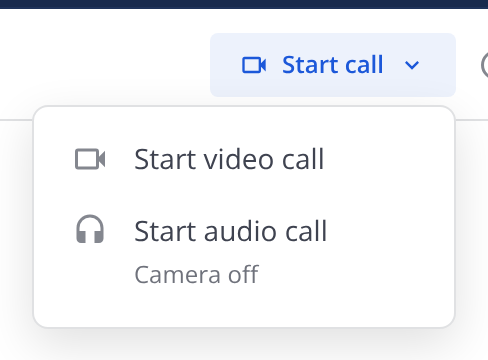

_The screenshot above shows the earlier text button and menu; it needs retaking for the icon-only button, the Mattermost call and Phone call groups, Copy call link and Call settings._

**Sidebar in-call icon.** A conversation row with a running call shows the in-call icon.

- The open conversation's row shows it while a call runs there: DM when calling, incoming, joining or active; GM / channel from the moment a call runs (Ongoing) through pre-join (join mode) and In call.
- Starting a new group call from No call does not mark the row during pre-join; it marks once you are in the call.
- A channel elsewhere in the sidebar (Release Discussion in the prototype) always shows the icon, to demonstrate discovery.
- The icon is the same call icon whether the call is ringing or active, drawn on a green pill-shaped background. The prototype matches (the pill is drawn in the prototype with a style override, since compass-design draws the icon without a background).

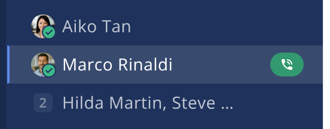

**Channel call banner (GM / channel, Ongoing only).** A green floating pill at toast height below the header, slightly wider than its text so the buttons sit apart: video icon, "N people in a call · 12:40", Join (inverted) and Dismiss (X) at the right, with extra space between Join and Dismiss.

- Slides in from the header edge and slides off when dismissed or when you join (Compass `--duration-quick`, entrance / exit easings; no motion under reduced motion).
- Dismissing hides it for the rest of the conversation visit; a later call (after No call) shows it again.
- The elapsed time updates live every second while the banner is showing, starting from the running call's start time (the prototype's call has been going 12:40 when the conversation opens). The call card's "N minutes ago by [name]" uses the same start time, so the card and banner agree. The participant count is live in product; in the prototype it follows the People control.

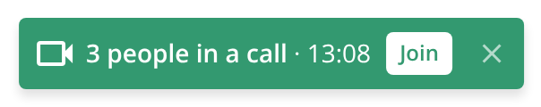

**Call card (post in the message list).** The card's states and copy (Calling, Connected, Canceled call, No answer, Declined, Ended) are defined in the [Calls UX Improvements for DM Calls](https://mattermost.atlassian.net/wiki/spaces/DES/pages/4653645825/Calls+UX+Improvements+for+DM+Calls) spec and are not repeated here. It stacks at narrow widths (Figma Narrow); hover adds a shadow. In a GM or channel the card shows Active with Join call while you are not in the call, and Joined with Leave once you are; its "N minutes ago by [name]" uses the same start time as the call banner.

### Pre-join

**The interstitial is the default when starting a call** (DM, GM and channel, in Video and Audio mode). Two settings control it:

- **Calls plugin settings (the person):** a setting to skip the interstitial and start immediately. The header call menu's "Call settings" row links to it.
- **System Console (admin):** the default for everyone. It is a default only, not a lock: a person's own setting overrides it, either way (skip when the admin shows it, show when the admin skips it).

With skip on, Start call rings a DM, or connects a group or channel call, straight away. The camera is as the menu item set it (Start video call: on, with the browser prompt; Start audio call: off).

The skip setting never applies to starts from a call link. Opening a call link that starts a call always shows the interstitial, because nothing in the link or in the menu label says it will start a call. It also never applies to Accept on an incoming call, which goes straight into the call (the "Joining…" state is only the connecting step), and phone calls never use it.

Audio mode (video disabled) uses the same interstitial without a camera: no self preview in the widget, a microphone-only check, and the window subtitle reads "Check your microphone first." The rest of this section describes Video mode.

The prototype has only the person's setting (a prototype control standing in for the Calls plugin settings) and a control that simulates opening a call link. The System Console default is not prototyped.

_Question: does the skip setting also apply to Join call on a call that is already running? The prototype says no: joining always shows the interstitial._

Opens in the widget (default) or the window. Never touches camera or microphone on load.

- Camera is off by default, unless Start video call was chosen from the header menu. In that case video is enabled by default in pre-join: the camera is on when pre-join opens and the browser prompt appears at that moment (the menu pick is the user gesture). Start audio call, Join call from the banner or header, and Call back all open pre-join with the camera off. In any pre-join the camera icon turns the camera on and triggers the browser prompt; nothing is requested on page load. While the camera starts the preview shows "Starting camera…".
- Title (widget and window): "Start call with <name>" (start) or "Join call with <name>" (join), where <name> is the peer, the group or the channel (for example "Start call with Marco Rinaldi", "Join call with UX Design"). The window adds the subtitle "Check your camera and microphone first."
- Mic level meter: simulated until the person selects Check my microphone, which requests the microphone and drives the meter from real input. Helper text explains the state: simulated, "Say something to see the meter move", blocked, or no working microphone.
- Test speakers plays the join chime for 1.5s and the button reads "Playing…". Disabled when sounds are off (helper text points to the prototype sound toggle).
- Who copy (window only): DM start "<name> will be called"; group start "<names> will be notified" (or "Everyone here will be notified" when the member list is empty); group join: avatars plus "<names> are in the call". The widget pre-join shows no "will be notified" copy: in start mode it shows only the self preview, controls and Start call / Cancel (in that order); in join mode it adds "N people in the call" with avatars. _Verified in the running prototype (widget). Window copy read from code._
- Buttons: Start call (or Join call) on the left, in green (the same green as Join call on the call card), and Cancel on the right, text only with no hang-up icon (it returns to the conversation and releases the camera). Call surfaces follow the in-call layout, where Leave and Cancel sit at the right, rather than the standard modal convention (Cancel left, primary right). This is deliberate; do not flag it as an inconsistency.
- Mic and camera controls are segmented: toggle plus a chevron that opens the device list.

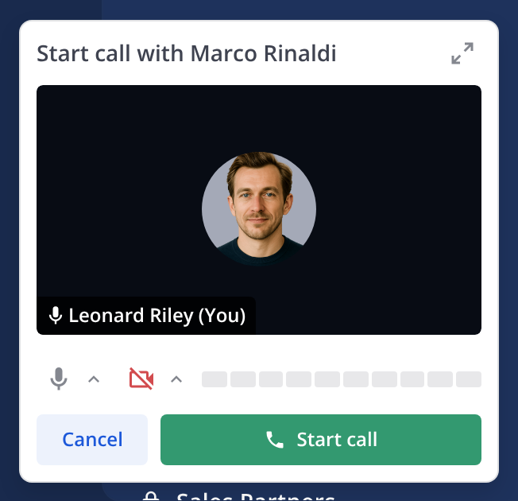

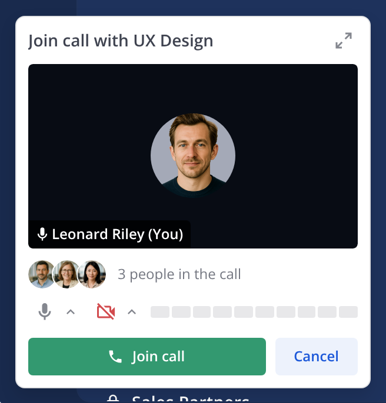

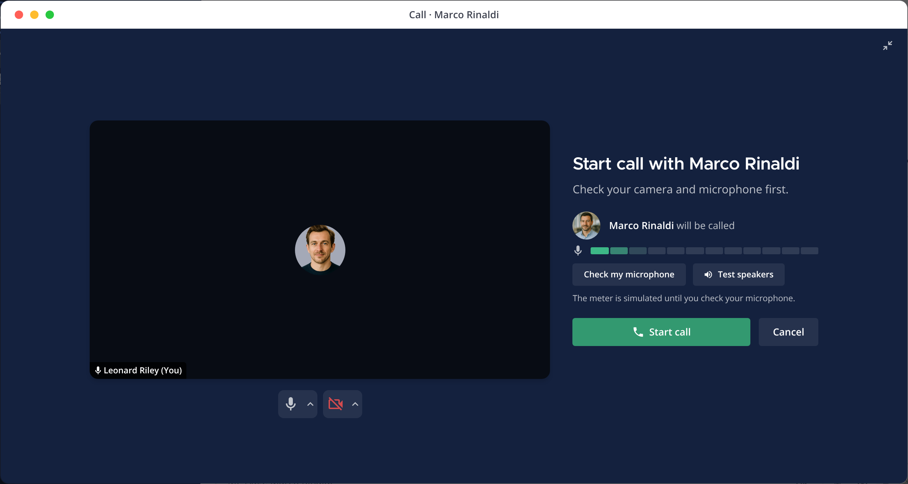

_The pre-join screenshots predate the new button order (Start call left, in green, and Cancel right) and need retaking._

### Call widget

Over the sidebar bottom-left. One card stays mounted across pre-join, calling, joining and active; content crossfades (quick duration) and the media row animates height.

- Draggable anywhere inside the channel area; releasing snaps to the nearest corner with equal insets in all corners. The chosen corner stays pinned when the card changes height. Presses on buttons and menus do not start a drag.
- Title is the conversation name: the peer (DM), the group (GM: first names of up to three members) or the channel.
- Persistent segmented mic and camera controls with device chevrons; the menus match the widget width. (Video mode. Audio and Phone modes show the microphone control only.)
- Active (Video mode): elapsed time, recording dot when recording, a 16:9 video area, participant count (opens a participants popover), share screen, More, Expand, Leave (square hang-up). While you share, the video area gives way to the sharing state (see Screen share).
- In Video mode the widget video is always speaker view: the person talking (otherwise the first remote person) fills the 16:9 area with their mic state and name bottom-left, and you sit in a small self picture-in-picture (no mute indicator there, since the mic control already shows it; a smaller avatar on a lighter fill when your camera is off). A "+N" chip counts other remote people who are not shown. There is no grid view in the widget.
- Calling and joining are compact in Video mode (a small avatar block, no large video area), and more compact in Audio and Phone modes (see below); the card resizes for each state and keeps the widget's corner pinned. Calling, joining and live share one width.
- Participants popover: opens above the card, and scrolls once the list is longer than it (from about five people).
- More menu: Audio output, Raise / Lower hand, Record call / Stop recording, Show chat thread (expands to the window with the chat pane), Call info. Escape or an outside click closes menus; one menu is open at a time.
- Incoming: caller avatar with a small call-type badge (video icon), "Incoming video call", Decline (tertiary) and Accept (green, the same green as Start call and Join call). Accept goes straight into the call with no pre-join step. The component also supports an audio variant (phone badge, "Incoming audio call"), which the prototype shows in Audio mode (video disabled). _Question: should an incoming audio-started call on a server with video show the audio variant, and does Accept then join with the camera off?_
- Joining (after Accept): "Joining call with <name>…" over the caller's avatar, with mic and camera controls (the microphone only in Audio mode) and a red Cancel. The chat card reads "Joining <name>…" / "Connecting…".
- Button colours: the DM Calls UX spec plans a red Decline and a green Accept for 1:1 incoming calls (marked deferred to a next phase). The prototype now shows a green Accept (the same green as Start call and the Join call card) with a tertiary Decline. _Question: adopt a red Decline as well?_
- People button: hidden in a 1:1 DM, where it is not meaningful, per the DM Calls UX spec (widget and call window). It stays in group and channel calls.
- Enter and exit are quick fades; exit plays after Leave, Cancel or Decline.

_Known gap, out of scope: the widget More menu still repeats Microphone and Camera rows next to the segmented controls._

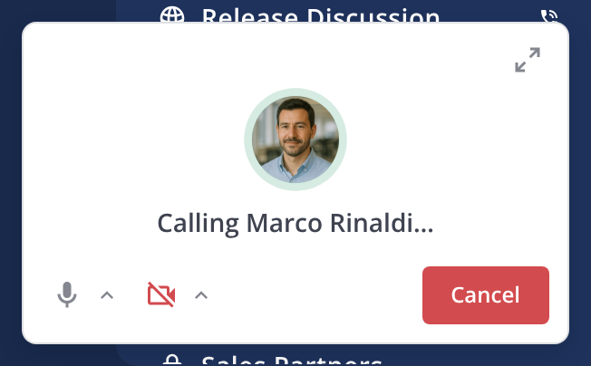

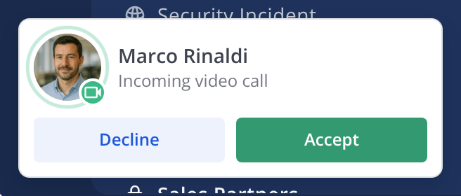

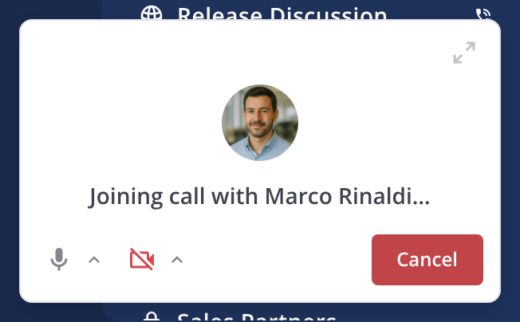

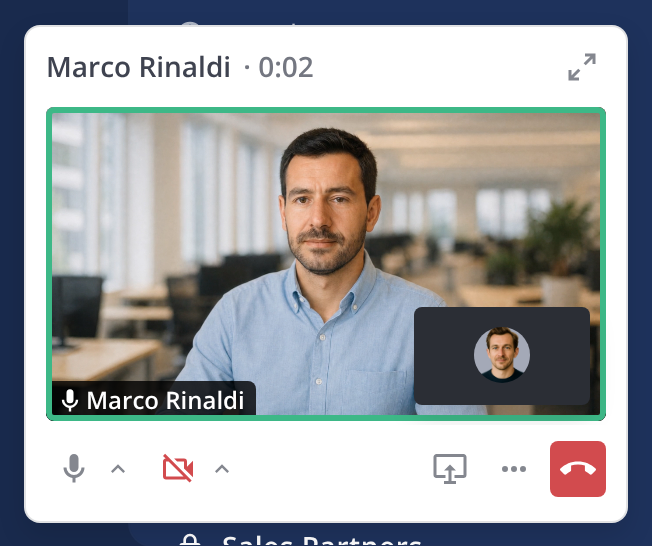

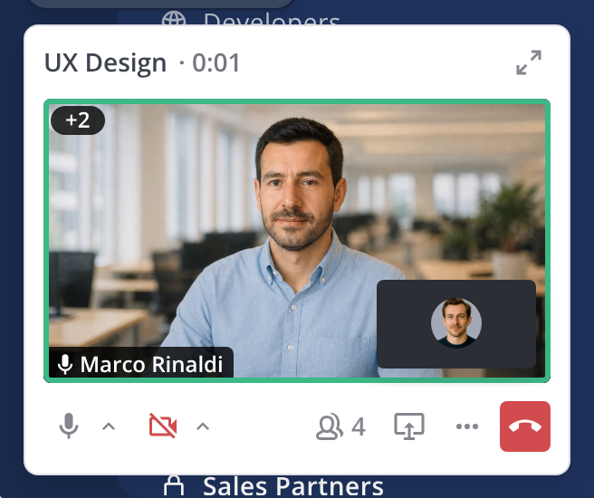

_The widget screenshots above predate the green Accept, the hang-up icon on ringing Cancel and the notice stack. There are no screenshots yet for the Audio and Phone widgets, the audio room window or the header button states._

### Call window (popout)

Dark surface floating inset over the conversation, which stays visible; a scrim covers the channels frame only. Phases that expand: pre-join, calling, active. Incoming, joining, No call and Ongoing are widget-only, and a Phone call never expands (widget only).

- Title bar: "Call · <conversation name>". Header: elapsed time and participant count ("12:40 • 4 participants"), recording indicator when recording, share pill when sharing (Stop), view toggle (Speaker / Grid) at right.
- Controls bar (three zones): participants; mic and camera (segmented, with device menus), share, reactions, raise hand; chat (blue unread dot), More, Leave.
- Side panes (participants, chat thread) slide in over the right edge like the right-hand sidebar, per the RHS overlay pattern (docs/RHS-OVERLAY-PATTERN.md), and the stage resizes with them. Panes share one width. Only one pane at a time. Chat messages persist for the call.
- Shortcuts while the window is open: Ctrl/Cmd+D toggles the microphone, Ctrl/Cmd+E toggles the camera (ignored in text fields).
- Collapse returns to the widget.

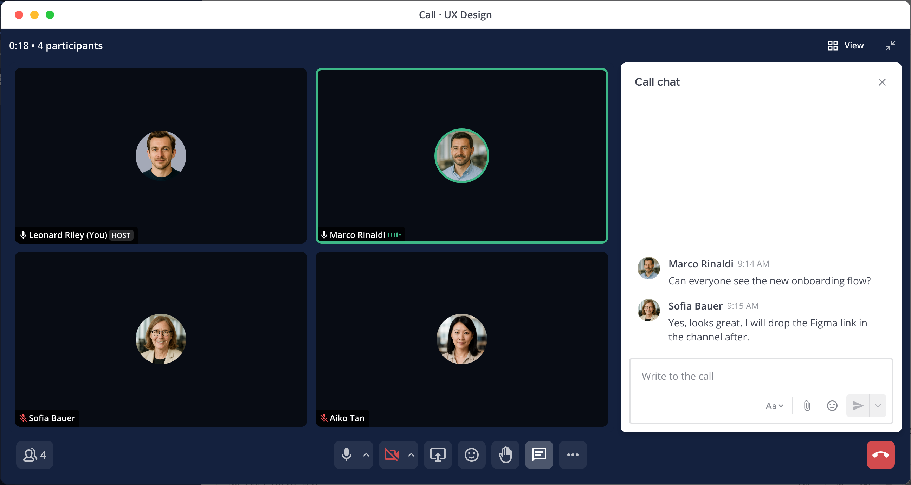

**Audio mode window (video disabled).** The window follows the old-style call room, as in the external call participants prototype and the compass-proto call popout, instead of the video stage:

- No Speaker / Grid view toggle in the header (the header keeps the time and participant count, the recording indicator and the share pill), and no self-view picture-in-picture.
- The stage is a room of avatars, wrapped and centred, with no video tiles: each person is an avatar with their name below (yours reads "(You)"), a mute badge, a HOST label, a talking ring (not shown when muted), a raised-hand overlay and a reaction. Avatars are medium up to six people and small beyond.
- The controls bar has no camera control, and Ctrl/Cmd+E does nothing. Everything else (participants and chat panes, share, reactions, raise hand, More, Leave) is as in Video mode.
- Host actions on a person (Mute, Make host, Remove from call) are not on the avatars in the prototype. _Question: where does the host menu live in the audio room (avatar overflow, as the compass-proto avatar offers, or only in the participants pane)?_
- While you share your screen the window still uses the share layout (shared content with a filmstrip of avatars).

### Stage layouts (2-10 participants)

Video mode only.

**Grid.** Equal tiles in rows chosen for near 16:9 tiles: 2 → [2]; 3 → [2,1]; 4 → [2,2]; 5 → [3,2]; 6 → [3,3]; 7 → [4,3]; 8 → [4,4]; 9 → [3,3,3]; 10 → [4,3,3]. A short last row is centred. Grid order is join order; speaking never reorders it. More tiles than cells collapse into a "+N" chip while keeping you, the presenter and the active speaker visible.

**Speaker.** 2 people: remote tile fills the stage with self-view picture-in-picture. 3+: the active speaker is featured in a large tile below one strip of everyone else, which runs along the top (you stay in the strip, never featured). When the speaker changes, the old featured tile swaps into the new speaker's strip slot. The strip pages when its tiles would drop below a minimum width (for example when a side pane narrows the stage): Previous and Next buttons (labelled "Previous participants, page N of M" and "Next participants, page N of M") flip between pages, tile size stays the same on every page, a shorter last page centres its tiles, and you are always on the first page. A page flip slides the tiles in the direction of travel. Paging is decided against the width the stage will have once a pane finishes sliding in, so the buttons do not flicker while it animates.

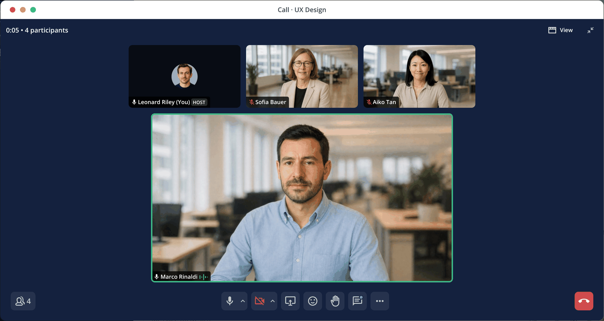

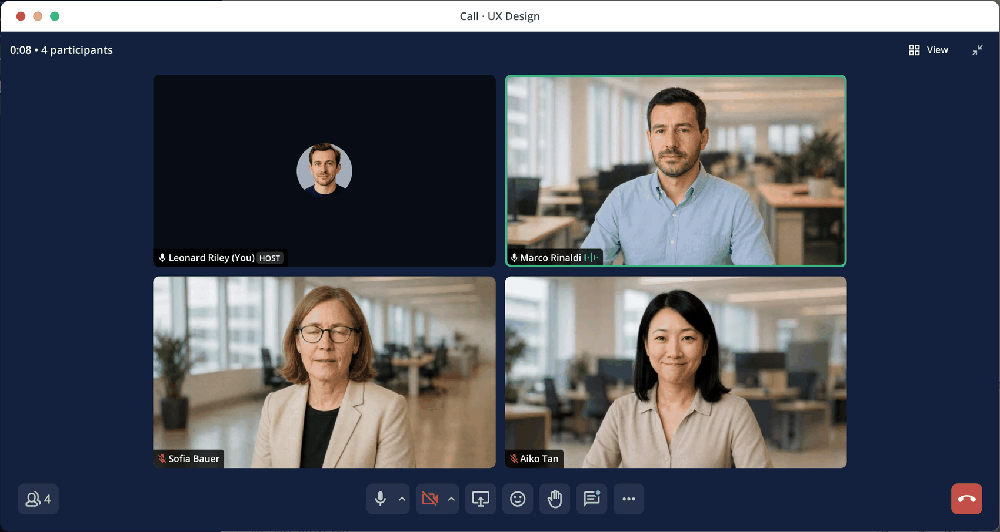

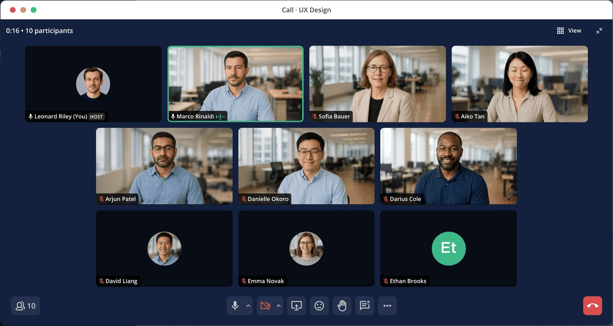

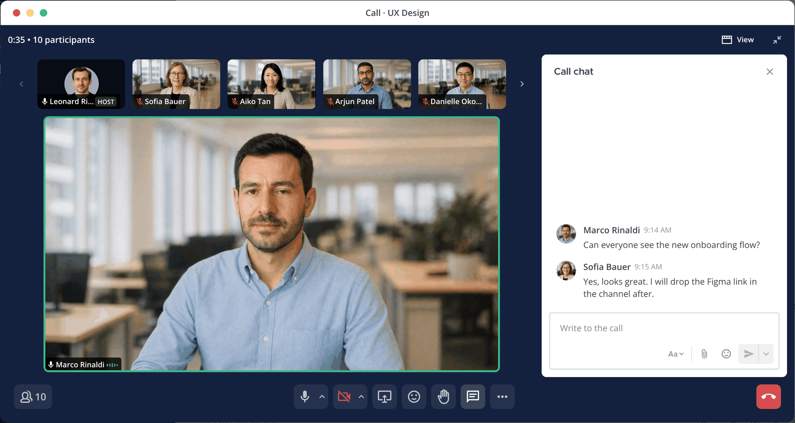

**Screen share.** Shared content fills the stage with a filmstrip of camera tiles (up to 6 cells including a "+N" chip). The stage tile is labelled "You are presenting" (or "<name> is presenting" for someone else), and the header shows a share pill: a red dot, "You are sharing <what>", and Stop.

How sharing starts and stops (widget and window behave the same):

- Select Share screen (widget controls or window controls bar) while In call. That click is the user gesture that opens the browser's own source picker; the page cannot list or preselect sources, and nothing is captured until the person confirms in the picker. Nothing is requested on load.
- Closing or cancelling the picker is silent: no share starts and no error shows. Any other failure posts a persistent device notice, "Could not start screen sharing."
- The share names what is captured: "your entire screen" (entire screen), "the <title> tab" (browser tab) or the window's title (window). The same wording appears in the widget and the window header.
- Stop sharing from the widget's Stop sharing button, the window's pill Stop, the Share screen control (now active), or the browser's own "Stop sharing" bar; all end the share. The capture is also released when you leave the call or the call phase changes.
- Sharing is only available while In call. It is not available in pre-join, calling or joining.
- Where the browser has no screen capture (and in the demo scenes), the prototype shows a stand-in slide and posts an info notice: "Screen capture is not available here. Showing a stand-in." The stand-in is prototype-only; the product has no equivalent.
- _Verified in the running prototype with a fake capture source; the browser picker itself cannot be shown in an automated browser._

Widget while sharing (Phase 1): the 16:9 video area is replaced by a live thumbnail of what you share (a small one; a monitor-share icon when there is no capture), a red dot with "You're sharing <what>", and a red Stop sharing button. Mic, camera, participants, share, More, Expand and Leave stay in place and the Share screen control shows its active state. _Question: in the widget the status text is cut with an ellipsis ("You're sharing your enti…"); allow two lines or shorten to "Sharing your screen"?_

**Self-view picture-in-picture.** Draggable with release velocity; settles into the nearest corner with a spring. Arrow keys move it between corners; Escape cancels a drag; a hide control collapses it to a "Show self view" chip.

**Tiles.** Name label with mute state; HOST tag next to the host's name (popout tiles only); active speaker border and sound wave (not shown when muted; yours too, see Your own speaking highlight); raised-hand badge; reaction pop (emoji shows 2.5s on the tile with a stage-wide burst); poor connection and "Reconnecting…" states. Remote tiles with the camera on play a muted looping clip, staggered so tiles never move in lockstep; a poster still shows before the clip loads and under reduced motion. A clip pauses on its still frame while the tile is scrolled out of view, in overflow or in a hidden tab, and resumes without restarting. A tile with the camera off, or with no clip, shows the avatar.

**Your own speaking highlight.** While you are in a call and unmuted, your tile gets the same active-speaker border and sound wave as everyone else's, but only while your microphone picks up your voice (a short hold of about 0.4 seconds keeps it on between words). It shows on your tile in the window (grid, strip and self view), on the widget's self view and on your avatar in the audio room. The browser asks for the microphone when the call goes live (starting or joining is the user gesture), muting stops the microphone and the highlight, and if access is blocked or no microphone is found there is no highlight and a permission or device notice appears. Only one person has the border at a time: yours while your microphone hears you, otherwise the other person speaking. It never changes the layout: the person featured in the speaker view is still chosen from the other people. The prototype never asks for the microphone in the walkthrough.

GM and channel calls are capped at 10 participants in Phase 2 (confirmed). Behavior at the cap (blocking the 11th person, copy) is not designed. _Question: what does the 11th person see when they try to join?_

### Host controls

Only the host sees host controls, on other people's tiles. Hover or focus the tile's label strip to reveal the "..." button, or right-click the tile. Menu: Mute (disabled if already muted), Make host, Remove from call (destructive). Each posts a notice ("Muted <name>", "<name> is now a host", "<name> was removed"). Make host moves the HOST tag; you stop being host. Leaving as host transfers host automatically (see Leaving and ending a call); End call for everyone is a host-only action that is not in the prototype yet.

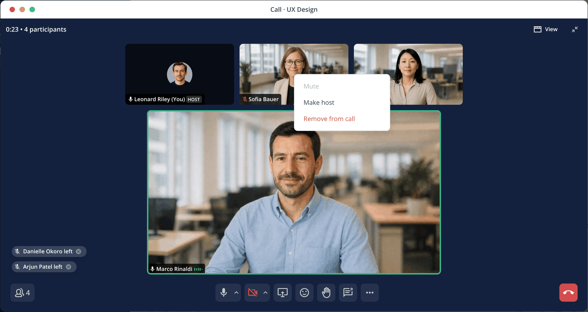

### Notices, recording and warnings

- Notices stack bottom-left of the stage above the controls, up to 5, newest at the bottom.
- Transient (joined, left, host, info, recording) fade after 3 seconds (200ms fade-off). Persistent until dismissed: network (warning), device (danger), permission (danger), and "Recording and transcription has started". When the stack is full the oldest transient notice drops first so warnings are not pushed off.
- Every notice is the proto call-notice pill, except the two recording notices: "Recording stopped" uses a compact popover with a record icon, and "Recording and transcription has started" is the popover notice below. Notices are not Toasts. The pill has no dismiss button, so a notice that stays until dismissed (network, device, permission) is dismissed by pressing the pill (its trailing close icon is the affordance; Enter and Space also dismiss).
- "Recording and transcription has started" is a persistent popover notice (record icon, title, the body "Consider letting everyone know that this meeting is being recorded and transcribed.", a primary Dismiss button and a close button). It stays until dismissed and is not dropped when the stack is full.
- **Appearance and tone.** The pill has two appearances: the dark pill on the call stage (window) and the light pill (`center-channel`, a light surface with a border) above the widget and on the header "Call link copied" notice. Network notices use the warning tone and device and permission notices the error tone: a solid fill with an alert icon, the same on either appearance, with the severity read to screen readers. Other pills keep the muted-microphone icon, including "joined" and "left" (see Deviations); "Call link copied" uses a copy icon.
- **In the widget.** The same stack shows above the widget card, the way its menus do (same width, newest at the bottom, up to 5). It steps aside while a widget menu is open and returns when it closes. Same kinds and timings as the window, with these differences, which follow mattermost-plugin-calls:
  - Shown: joined, host changes, recording started and stopped, and device, permission and network warnings.
  - Not shown: left. A leave is announced in the window only.
  - On joining, a short "You're muted. Select the mic to unmute." (or "You're unmuted. Select the mic to mute.") hint shows in the widget only.
  - Reactions are not notices in either surface. In the plugin's widget a reaction shows next to the person in the participants list; this widget has no reaction control yet.
- The stack sits over the bottom-left of the stage and can overlap tile name labels when a side pane narrows the stage (seen with the chat pane open at 4 people). _Question: reserve space or move the stack when a pane is open._
- When many people join at once (for example 4 to 10), up to 5 notices stack and the oldest transient one drops first.
- Recording: Record call in More toggles it, posts "Recording and transcription has started" / "Recording stopped", shows the recording indicator in the window header (with Stop) and a dot in the widget header. The ended call card lists the number of recordings.

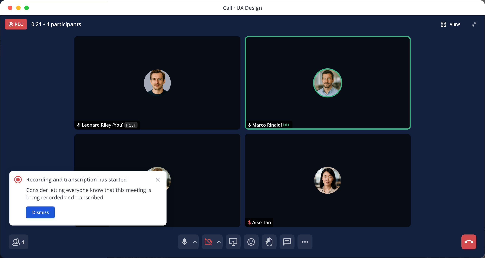

- Permission and device warnings: if the browser camera is blocked, a permission notice appears; if no camera is found, a device notice appears. _Verify exact copy in the running prototype._
- Network warnings: only the per-tile poor-connection and reconnecting states exist; no persistent network notice is triggered in the prototype.

### Sounds

Sounds follow the existing mattermost-plugin-calls (v2, LiveKit) behavior (read from the plugin source, not run):

- **Ring:** the incoming call loops the user's chosen call ringtone (default "Calm"); the caller hears the looped ringback while calling.
- **Join (you):** a join sound plays when you connect to the call, except a 1:1 DM caller with ringing enabled, who hears the outbound ringback instead.
- **Join (others):** a join sound plays when another person joins while you are in the call, only while fewer than 8 people are in the call (a user preference, default 8). Larger calls are silent for joins.
- **Leave (you):** a leave sound plays once when your own call connection closes, for any reason including a dropped connection or error.
- **Others leaving:** no sound.
- **No notification sound** for a new call while you are in a call (see Receiving a new call while in an active call).

Prototype differences:

- Now matching the plugin: the join-self sound plays when you connect (and for Test speakers); the join-user sound plays when someone else joins during the call, and for a 1:1 DM caller when the other person answers (after the ringback); the leave sound plays when you hang up; the incoming ring is the "Calm" ringtone and the outgoing ring is the ringback, both looped at full volume. _Playback is read from code; audio cannot be heard in the automated browser._
- Still different: the join-user sound plays for every join, with no "fewer than 8 people" limit, and the leave sound plays only on Leave (not on a dropped connection). Cancel and Decline are silent.
- _TODO: apply the 8-participant limit to join sounds and play the leave sound on connection loss._

Sounds are on by default in the prototype with a toggle in the prototype chrome (not product UI); the product uses the user's calls sound preference. Browsers may block audio before a user gesture; the failure is silent.

---

## Motion

Compass durations and easings only: quick (150ms) with entrance / exit easings for banner, crossfade, notices, panes and widget enter / exit; moderate (300ms) with the transition easing for widget media-row height and corner snapping. Under `prefers-reduced-motion`, these animations are disabled; corner snapping is a position change without easing. The header button's tooltip and the Call link copied notice fade with the quick duration, and the menu chevron rotates 180° with the quick duration while the menu is open. The "Calling…" title in the compact widget fades between full and about half opacity on a loop of about 1.6 seconds (a looping pulse has no motion token, and it dips below the 72% text opacity floor; see Open Questions). All of these are off under reduced motion. The self-view picture-in-picture uses a spring (stiffness 420) when settling after a drag. _Verify reduced motion for the PiP spring._

## Accessibility

- Every control has an accessible name (for example "Hide self view", "Dismiss notification", "More options", "Expand call window"); toolbars and regions are labelled ("Call notifications", "Active call", "Outgoing call", "Joining call", "Call setup").
- Call state changes use polite live regions (calling, joining, notices, helper text); the incoming widget is a dialog.
- Keyboard: Escape closes menus; arrow keys navigate device and participant menus (Home also supported in device menus); arrow keys move the self view; Ctrl/Cmd+D and Ctrl/Cmd+E for mic and camera. _Verify focus order and Tab reachability of the draggable widget._
- Tiles expose "<name>: <status>" (speaking, hand raised, host, muted, poor connection).
- The window's View button shows the text "View" but its accessible name is "Change call layout", so the visible label is not part of the name (WCAG 2.5.3 Label in Name). _Question: rename to "View" or "View: change call layout"._
- A participant with no avatar image shows initials on a green disc (for example "Et"); the name label stays the accessible name.
- Contrast: white text on green-600 is 3.54:1, which passes only for large text or UI components; green-700 is 5.2:1 and passes for body text. _Question: which surfaces use green-600 for small white text (Join banner, Start call button)? Move small text to green-700 or enlarge._
- The header call button is an icon-only button named "Start call", "Join call" or "In call"; the menu button reports its popup and expanded state, and the In call button reports pressed. Its tooltip shows on hover and on keyboard focus, and is hidden while the menu is open.
- A pill notice that stays until dismissed (network, device, permission) is a button named "Dismiss notification: <message>" and also responds to Enter and Space; warning and error pills keep the severity ("Warning" / "Error") in that name.
- The audio room is a group named "Participants in the call"; each person is an avatar with their name, and mute, host and speaking state are exposed as on video tiles. Your own tile exposes "speaking" while your microphone hears you.
- The compact widget header is a live region while calling and joining, so "Calling <name>…" is announced.
- Reduced motion: see Motion.

---

## Components Used / New Components

Existing (Compass UI): Button, IconButton, Icon, UserAvatar, UserAvatarGroup, Tag, PopoverMenu (with group titles and dividers), MenuItem, MenuGroupHeading, Tooltip, ModalOverlay.
Existing (Compass proto): ChannelShell, ChannelHeader, Message, MessageInput, CallNotice pill (with the `appearance` and `tone` props from compass-design PR #180), CallParticipantAvatar, WithTooltip, RecordingIndicator, CallInfoPanel, ParticipantsPanel.
New in the prototype (candidates for the design system): CallHeaderButton, AudioRoom, CallCard, CallBanner, VideoCallWidget, VideoCallWindow, VideoStage and VideoTile, SelfViewPip, CallControlsBar, SegmentedIconButton, DeviceMenu, WidgetIncoming, PreJoinPanel, MicLevelMeter, ViewToggle.

## Deviations from Figma

The prototype wins. Differences found so far (structure only; a pixel comparison was not possible because Figma image export was blocked in this session):

1. The Call Card Figma file predates the states in the [Calls UX Improvements for DM Calls](https://mattermost.atlassian.net/wiki/spaces/DES/pages/4653645825/Calls+UX+Improvements+for+DM+Calls) spec (Calling, No answer, Declined, Canceled) and should gain variants for them. The Call back action on declined and missed cards is prototype-only and is not in that spec. _Question: is Call back intended?_
2. The Video-Calling board (1335:418726) shows an older widget and call room (participant grid, screen share grid, widget controls). The prototype's widget (persistent segmented controls, one card across phases), window, banner and sidebar icon have no matching frames. Neither do the icon-only header button, the Start call menu groups, the Audio and Phone widgets, the audio room window or the widget notices.
3. Prototype-only decisions to confirm with design: remote tiles play generated placeholder loops, not real video; the widget More menu still has duplicate Microphone and Camera rows; the neutral notice pills still use the mic-off icon for every message (only warnings, errors and Call link copied differ); the Speaker and Grid view glyphs are a custom SVG and a compass-icons `apps` glyph because the compass-icons set is missing a view glyph and Wi-Fi icons.

## Open Questions

0. Receiving a new call while in an active call: current plugin behavior is documented in UX Functional Behavior (no ring, condensed notification, "Leave and join new call" modal). Ring and join-modal behavior stay as in the plugin; the remaining video-specific questions are open.
1. _Resolved:_ a 1:1 DM call ends when either person leaves. In all other cases the call continues until the host chooses End call for everyone; if the host leaves, host transfers to the earliest-joined remaining participant. _Prototype now follows the leave rules; End call for everyone and host transfer are still to do (see Leaving and ending a call)._
2. _Resolved for Phase 2:_ the GM and channel cap is 10 participants. Phase 3 (large calls) is separate.
3. Should the call banner dismissal persist across sessions or only for the current visit?
4. _Resolved:_ the banner live-updates (elapsed time and participant count). The prototype now ticks the elapsed time; the count follows the People control.
5. Green-600 versus green-700 for small white text (3.54:1 versus 5.2:1).
6. _Resolved:_ the call card states for DM calls, including what the caller sees on decline, no answer and cancel, are defined in the Calls UX Improvements for DM Calls spec.
7. Which events produce persistent network warnings, and what is the copy?
8. _Resolved:_ sounds follow mattermost-plugin-calls v2 (see Sounds). The prototype now plays join-self, join-user and leave; the 8-participant join limit and leave-on-disconnect are still to do.
9. _Resolved:_ GM and channel calls have no incoming call notice, so there is no Audio only choice there; people join from the Ongoing banner, header Join call or call card. Remaining question: should the 1:1 DM incoming widget offer Audio only? (The unused `IncomingCallCard` component has it; the widget does not.)
10. Where should the Figma board be refreshed so it matches the prototype?
11. What does the call link open, and does copying it before a call exists reserve a call? The prototype copies the existing demo link and creates nothing. Should Copy call link also be offered during an ongoing or active call (for example from the Join call state)?
12. Phone calls (see Outbound phone calls alongside video): no pre-join for phone calls (and no microphone check), DM anchoring when the number is not a Mattermost user, and whether phone calls get their own sidebar glyph.
13. Should clicking the In call header button bring the call widget forward (for example when it has been dragged away or the window is open)?
14. Where does the host menu (Mute, Make host, Remove from call) live in the audio room: the avatar overflow, or only the participants pane?
15. Is there a microphone check for audio-only calls when pre-join is skipped, and for phone calls?
16. Contrast of the warning and error pill tones (both below 4.5:1, matching the Toast) and of the green in-call header icon on a light surface.
17. The "Calling…" title fade dips to about 55% opacity, below the 72% text floor, and uses no motion token. Keep it, or change it?
18. Does the skip-pre-join setting also apply to Join call on a call that is already running? The prototype says no.

## References and Resources

- Prototype: [Video Calls](https://video-calls-prototype.vercel.app/prototypes/video-calls) (mattermost-proto-playground, PR #84)
- Figma: Video-Calling (WcvNikeYFxnW15IaZU9JM0), Call Card (uHkbu1krioaScJ3AfxLPg2)
- RHS overlay pattern: docs/RHS-OVERLAY-PATTERN.md in the prototype repo
- Related UX specs: Calls UX Improvements for DM Calls; UX Spec: Outbound Calls — Implementation Tiers; Phase 1 — Basic Outbound SIP Calling (links under Overview)
- Related: FY28 Multi-party Video two-pager (background only)
