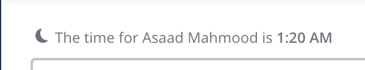

# Working Hours — docs

The Confluence spec is titled "Notification Schedule"; the feature is now named **Working Hours** (see `working-hours-spec.md`, "Working Hours changes").

| Item                                  | Link                                                                                                                                                                                       | Type        |
| ------------------------------------- | ------------------------------------------------------------------------------------------------------------------------------------------------------------------------------------------ | ----------- |
| UX spec                               | [UX Specs: Notification Schedule](https://mattermost.atlassian.net/wiki/spaces/DES/pages/2790817794/UX+Specs+Notification+Schedule) (source: `working-hours-spec.md`)                      | requirement |
| Figma — Desktop / Web                 | [MM-35343 DND, Snooze Notifications & Schedule](https://www.figma.com/file/n8UMdoMmqMNtEtKJapGPe5/MM-35343-DND-Snooze-Notifications-%26-Schedule?type=design&node-id=527-4740&mode=design) | requirement |
| Figma — Mobile (see mobile prototype) | [MM-34576 Mobile DND, Snooze Notifications](https://www.figma.com/file/uRHZ6JHIpYF52JTZRPqe3e/MM-34576-Mobile-DND-Snooze-Notifications?type=design&node-id=629-10296&mode=design)          | requirement |
| PRFAQ / Jira / eng brief              | Not provided yet                                                                                                                                                                           | —           |

Note: the Figma files were not opened when the prototype was first built; layout follows the spec text and Compass components. Compare against Figma when reviewing.

Mobile lives in its own prototype: `../../working-hours-mobile/`.

`shots/dm-late-hours-notice.png` — the existing webapp notice (moon icon + "The time for {name} is {time}") above the message input in a DM. **requirement** (reference for the notice the prototype recreates).

## Prototype screenshots

Captured from the prototype (not design sources) in `shots/`: `01-settings-collapsed` … `11-dm-no-notice-in-hours` (includes close-ups of the account menu and the DM notice). **background**
